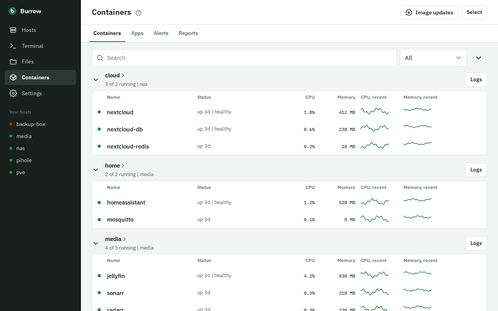
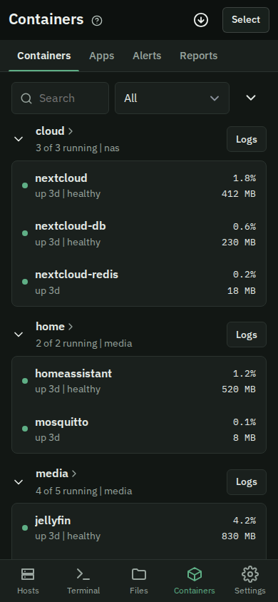
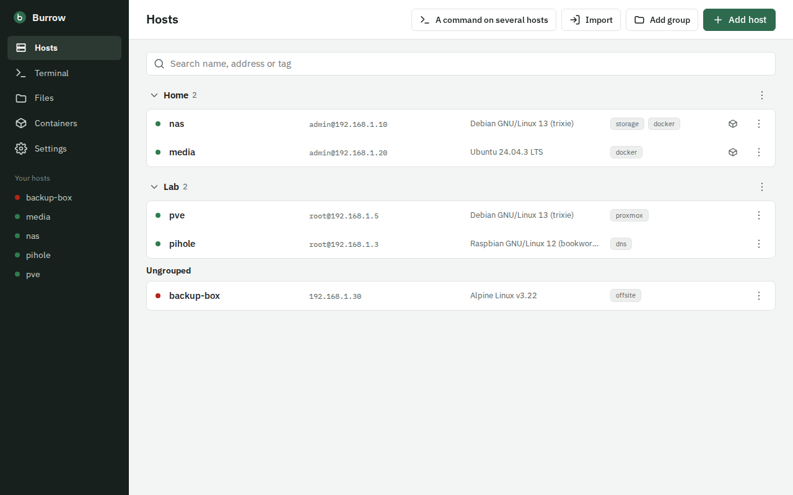

# Burrow

**Your homelab from your phone.** One self-hosted app - a web app, plus an
Android app - that replaces the SSH client, the server file manager, the log
viewer and the browser IDE you use for day-to-day admin.

## Why Burrow

- **Ask what is wrong, get a fix.** Tap *Analyse* on a log or an alert:
  a language model explains the cause and proposes fixes, each
  with its risk; reports explain each container that needs a look. You
  read the command and run it from there - nothing runs by itself. Your
  own model (Ollama) recommended, Claude, Gemini or any OpenAI-compatible
  server if you want; what looks like a secret is masked (and addresses too, unless
  you say the model runs on your own network) before anything leaves - by patterns, so read
  [docs/USAGE.md](docs/USAGE.md) for what they catch. Or hand the same question to Claude or
  ChatGPT in your own browser.
- **Your apps from anywhere, without a VPN app or a proxy per app.** The
  Android app has its own WireGuard: away from home it reaches Burrow, your
  hosts and your container apps (Jellyfin, Home Assistant, ...) through
  your tunnel by itself, at their home addresses, in tabs that stay signed
  in. No VPN app to switch on, and it works next to another VPN.
- **Nothing on your hosts.** No agent, no Docker socket: everything goes
  over SSH as a user you choose. A host needs sshd and Docker, nothing more.
- **A terminal made for a phone.** Sessions run on the server, so a closed
  tab, a phone that lost its network or a switch to your laptop picks up
  the same screen. Type in a text box of your own (with your keyboard's
  corrections) and send it, or straight into the terminal; auto-complete
  from your history, command specs, paths and container names; AI turns a
  sentence into a command; a key bar and the volume keys as Ctrl and arrows.
- **Updates with a safety net.** Which images are out of date, with their
  release notes; automatic updates in a maintenance window that wait after
  a breaking change and roll back to the previous image when the new
  container misbehaves (the image, not data a new version migrated; see
  [docs/USAGE.md](docs/USAGE.md)).
- **When Burrow itself is down.** The app keeps a direct SSH route to your
  hosts, and fingerprint sign-in instead of passwords.

## A look

<p>
  
  
</p>


A made-up homelab; `e2e/tests/workspace-readme.spec.ts` makes these pictures.

## What it does

- **Terminals that keep running.** Close the tab, pick it up on your laptop:
  the same screen. Auto-complete from history, Fig specs, paths and container
  names; snippets; a key bar on the phone; AI text-to-command.
- **Files on every host.** Browse, upload (resumable), copy between hosts,
  edit with language servers (compose, Dockerfile, shell, YAML, JSON...),
  save through sudo, open a folder as a workspace with search, replace and git.
- **Containers and logs.** All hosts and compose stacks in one view with
  live CPU and memory; merged, filtered log timelines like Dozzle; container
  actions, a shell inside, compose edit -> diff -> deploy with live output.
- **Updates.** Which images are out of date, with release notes; opt-in
  automatic updates in a maintenance window, with rollback when the new
  container misbehaves.
- **Alerts and reports.** Crashes, out-of-memory kills, unhealthy containers
  and full disks raise alerts - pushed through ntfy, e-mail, Discord or a
  webhook; scheduled reports per container, explained by your own language
  model (Ollama recommended; Claude, Gemini or any OpenAI-compatible server optional),
  with secrets masked before anything leaves.
- **Host statistics.** CPU, memory, disks, temperatures and SMART.
- **Android app.** Fingerprint sign-in, share files to a host, app tabs for
  your other web apps, a direct SSH route for when Burrow is down, and its
  own WireGuard: away from home it reaches Burrow, app tabs and hosts
  through your tunnel by itself, without a VPN app and next to another VPN.
- **Problem reports.** From the screen where something goes wrong (or a
  shake of the phone), with a screenshot and the last 30 seconds of input;
  saved on your own server, nowhere else.
- **More people.** Invite links, an operator role that can look but not
  change (files only in the folders you allow), single sign-on (OpenID
  Connect).

## Security model

Burrow is a shell into every host you add. Treat it that way:

- **Never expose it to the internet.** Reach it over your LAN or a VPN
  (WireGuard) through a reverse proxy with TLS.
- Authentication is built in and cannot be switched off: passkeys first,
  password + TOTP as fallback, recovery codes, optional single sign-on.
  Acting on a host (a terminal, a command on several hosts, container and
  stack actions, deleting files, root edits) and changing users, sign-in,
  paired devices or updates, and adding or changing hosts, keys and their
  credentials, need a fresh confirmation (step-up); saving a file you edit
  does not ask again.
- SSH keys, host passwords and other secrets are encrypted at rest
  (AES-256-GCM) with a master key in the data volume. **Back it up.**
- Host keys are trusted on first use after you confirm the fingerprint.
- The container runs as non-root with a read-only root filesystem and no
  capabilities. Everything Burrow does on a host goes over SSH as the user
  you give it; it never gets the Docker socket.

## Install

Requirements: a Linux machine with Docker and Compose v2, git, and a
reverse proxy that serves Burrow over https (Caddy, Traefik, nginx, SWAG;
[docs/INSTALL.md](docs/INSTALL.md) has a recipe for each, and a way to try
it without one).

```sh
git clone https://github.com/R31l4nd/Burrow.git burrow && cd burrow
cp .env.example .env          # set BURROW_ORIGIN, the https URL you will open
docker network create proxy   # the network your reverse proxy is on
docker compose up -d --build
docker compose logs burrow    # prints the one-time setup token
```

Then point your proxy at `http://burrow:8080` (INSTALL.md, step 3), open
`BURROW_ORIGIN`, enter the token, create your account and register a
passkey, then add your hosts. The full walk-through - reverse proxy, a quick
try without one, the Android app, backups - is in
[docs/INSTALL.md](docs/INSTALL.md).

## No telemetry

Burrow sends nothing about you or your use anywhere. It reaches out only
for what you set up or ask for: your hosts over SSH, the image registries
of your containers (to see whether an image has a newer build), GitHub's
release notes of those images, your notification channels, and a language
model if you choose an external one (what looks like a secret masked
first). Problem reports stay on your own server.

## How it compares

- **Portainer, Dockge, Komodo** manage Docker through the Docker socket
  or an agent on every host. Burrow needs neither: it does everything over
  SSH as a user you choose, so a host needs nothing installed but sshd and
  Docker, and Burrow itself never holds the socket.
- **Dozzle** is a log viewer; Burrow has the merged log timeline too, plus
  log files beside a container's output, alert rules on them, and reports.
- **Termix, Nexterm** are SSH suites in the browser; Burrow's terminals
  run on the server (they survive a closed tab and a phone that lost its
  network) and the Android app is built for a phone: its own WireGuard,
  fingerprint sign-in, a key bar and the volume keys as Ctrl and arrows.
- **Termius** and other SSH apps keep your keys in the app on each device (or in their cloud); with
  Burrow they stay on your server, encrypted.

## Documentation

- [docs/INSTALL.md](docs/INSTALL.md) - installing, step by step
- [docs/USAGE.md](docs/USAGE.md) - using Burrow
- [docs/DEPLOY.md](docs/DEPLOY.md) - configuration, backups, upgrades
- [docs/DEV.md](docs/DEV.md) - development and the test gate; [CONTRIBUTING.md](CONTRIBUTING.md) for changes
- [docs/DESIGN.md](docs/DESIGN.md) - architecture; decisions in [docs/adr/](docs/adr/README.md)
- [CHANGELOG.md](CHANGELOG.md)

## Problems and questions

Something not working? In Burrow, Settings -> Report a problem sends the
screen and what led to it to the admins of your own Burrow; nothing leaves
your server. An admin reads it under Reports received and can open a
[GitHub issue](https://github.com/R31l4nd/Burrow/issues/new?template=bug_report.yml)
filled in from it, after checking it for anything private. Security
problems: please report them privately, see [SECURITY.md](SECURITY.md).

## Third-party data and programs

Completion specs: [withfig/autocomplete](https://github.com/withfig/autocomplete),
MIT licence, served unmodified under `/fig/`.

The image carries these programs for the editor, unmodified, at the
versions pinned in the `Dockerfile` (their source is at each link):

| Program | Licence | Source |
|---|---|---|
| ShellCheck | GPL-3.0 | <https://github.com/koalaman/shellcheck> |
| hadolint | GPL-3.0 | <https://github.com/hadolint/hadolint> |
| shfmt | BSD-3-Clause | <https://github.com/mvdan/sh> |
| Ruff | MIT | <https://github.com/astral-sh/ruff> |
| Taplo | MIT | <https://github.com/tamasfe/taplo> |

## License

[GNU Affero General Public License v3.0](LICENSE) (AGPL-3.0-only). You may
use, change and share Burrow; if you offer a changed version to others over a
network, you share its source too.

Copyright (C) 2026 R31l4nd
